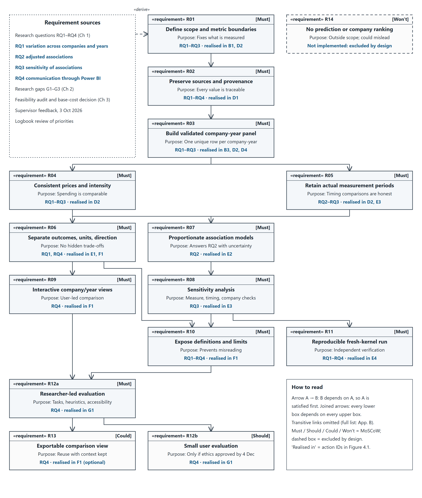

# 4 Design

This chapter explains how the requirements were gathered, how they depend on one another and where each is realised in the project workflow. Figure 4.1 models the whole project as a UML activity diagram. Figure 4.2 models the requirements and links each one to the Figure 4.1 actions that satisfy it. Together they provide the traceability chain used throughout the rest of the report: research question → requirement → action → artefact location. Appendix B records this chain in full.

{height=21.5cm}

## 4.1 How the requirements were gathered

The requirements came from five sources, shown in the left panel of Figure 4.2:

- the research questions;
- the research gaps G1–G3 identified in Chapter 2;
- the feasibility audit, including the decision to adopt Ofwat's single-definition base-cost series and a balanced 2017/18–2024/25 window;
- the supervisor's feedback of 3 October 2026, which asked for traceability from the artefact back to each question and for links between requirements and UML;
- a logbook review of priorities.

That review raised sensitivity analysis (R08) and usability evaluation (R12) from Should to Must, because RQ3 and RQ4 cannot be answered without them.

A later realism review split R12 in two:

- **R12a (Must):** a researcher-led evaluation that needs no participants.
- **R12b (Should):** a small user study, which goes ahead only if ethics approval is obtained by a fixed date.

The split keeps RQ4 answerable whatever the approval timeline. Several acceptance tests were also reworded at the same time so that each could be checked directly.

Three stakeholder roles were considered. The informed non-specialist reader needs comparisons that are clearly labelled. The researcher needs transformations that can be reproduced. The supervisor and examiners need an argument they can audit. No stakeholder interviews were conducted, so the requirements derive from these documented sources rather than from elicited user statements. Chapter 7 discusses this limitation.

Priorities use MoSCoW categories:

- **Must:** required for a valid answer or an auditable artefact.
- **Should:** strengthens the answer but depends on conditions outside the project's control.
- **Could:** an optional addition that must not delay essential work.
- **Won't:** deliberately excluded from this delivery.

## 4.2 Requirement dependencies

Figure 4.2 arranges the fourteen requirements by dependency. Each box states the requirement's purpose, the research questions it serves and the actions that realise it. Transitive dependencies are omitted for legibility.

{width=15.5cm}

The chain begins with scope and provenance:

- **R01 and R02** define what is measured and preserve where every value came from.
- **R03** builds the validated company-year panel on those foundations.
- **R04 and R05** depend on the panel. They fix the price basis, spending per property and the actual measurement periods.

Every analytical and presentation requirement then depends on both R04 and R05. Separate outcomes (R06) and association models (R07) would be misleading if prices or periods were inconsistent.

Two branches follow. On the analysis branch, models (R07) enable sensitivity analysis (R08), which feeds both the reproducibility requirement (R11) and the exposure of definitions and limits (R10). On the presentation branch, separate outcomes (R06) enable the interactive views (R09). Researcher-led evaluation (R12a) requires both the views and the documented limits. The user study (R12b) and the optional export view (R13) build on it.

The dependency structure also set the build order and the response to problems. A failure in an upstream requirement invalidates everything beneath it. Changes to scope were therefore recorded and re-checked from R01 downwards, never patched at the dashboard.

R14 (Won't) excludes prediction and any composite company ranking. A ranking would combine outcomes measured in different units and directions, which Section 2.2 argued against. Prediction would need a longer, validated series.

## 4.3 Whole-project workflow

Figure 4.1 shows the project from scoping to reporting. It has four partitions: researcher, Python pipeline, Power BI artefact and supervisor. Horizontal bands mark the report chapters.

Each action carries an identifier and tags naming the requirements, research questions and objectives it addresses. A reader can therefore move from any research question to the action and code that answers it. The sections of the analysis code carry the same tags (Chapter 5).

Three decision points structure the workflow:

1. **Spending comparability (B2).** Could total expenditure from before 2020 be joined to the current measure? No year exists in which both definitions were published, so the join could not be tested. The study therefore adopted Ofwat's base-cost series, which uses one definition for every year, and the balanced 2017/18–2024/25 window (B3).
2. **Validation (D3).** A failed check stops the pipeline. The failure is logged and corrected (D4) before the panel is rebuilt, so unvalidated data never reach analysis.
3. **Supervisory review (G2).** A requested change re-enters the workflow as feedback to the requirements (S2 → C1), not as an ad hoc edit.

After validation, the pipeline forks. Descriptive trends (E1, answering RQ1) run in parallel with the adjusted models (E2, RQ2), and sensitivity analysis (E3, RQ3) follows the models. The branches join before export and a fresh-kernel rerun (E4). Only these approved tables feed the Power BI report (F1, RQ4), which is then evaluated (G1).

## 4.4 Artefact architecture and data model

The artefact separates four layers:

- **Retained sources:** the original workbooks, left unchanged and identified by SHA-256 hash.
- **Preparation:** extraction, validation and construction of the panel.
- **Analysis:** descriptive, model and sensitivity outputs.
- **Presentation:** the Power BI report.

The presentation layer reads the approved tables; it does not refit any model inside a visual.

The Power BI model holds six flat tables written by the analysis, with no relationships between them. A filter on one page therefore cannot change a model result stored on another. Model estimates are kept separately from observed regulatory values, so an estimate cannot be mistaken for a reported figure. Each measure carries its unit, its direction of better performance and its period basis.

Component and use-case diagrams for the final artefact appear in Appendix B.

## 4.5 Ethics by design

The data are public, company-level regulatory statistics with no personal information. The main ethical risk is therefore misrepresentation. The design answers it with five rules, each of which is checked in the evaluation (Chapter 7):

- causal language is excluded throughout;
- legitimate zeros are displayed differently from missing values;
- no colour or default sort implies that high spending is good or bad;
- the company ranking excluded by R14 is not produced;
- uncertainty intervals accompany every estimate.

The user study (R12b) requires approval under UWE's research ethics procedures before any recruitment (UWE Bristol, n.d.a). If approval is not obtained in time, the study is omitted, not run informally. Appendix A records the ethical review and the disclosure of AI assistance.
